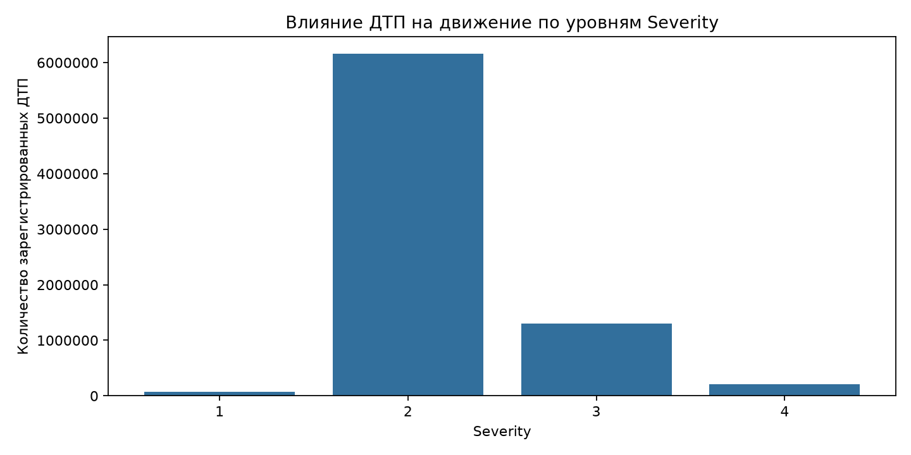
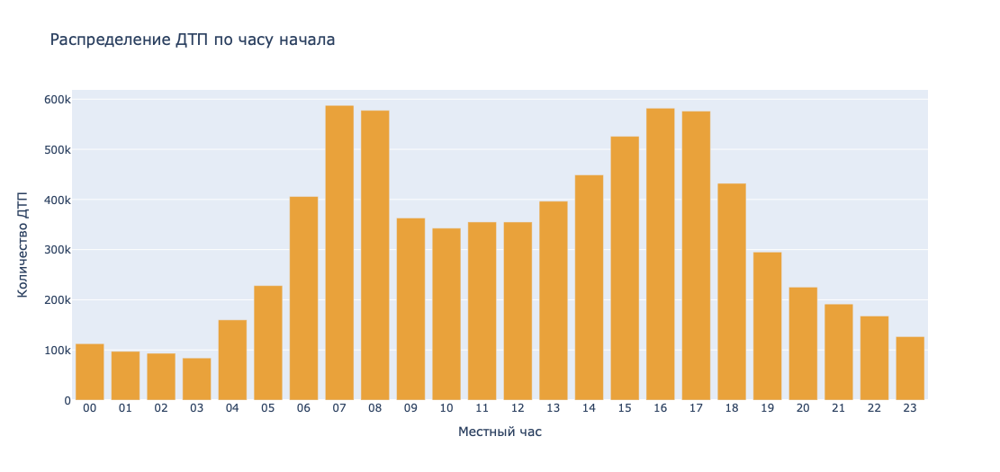
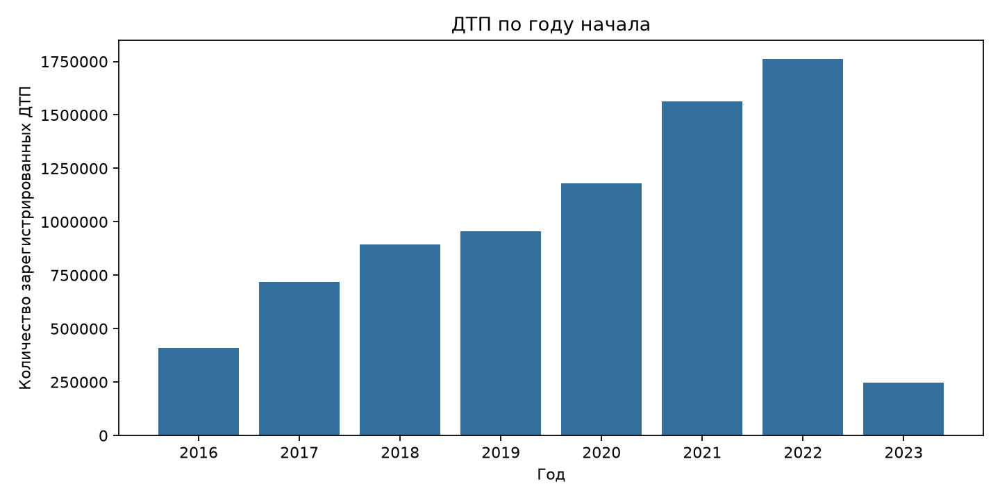
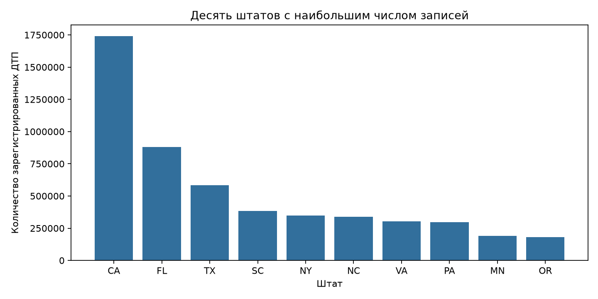
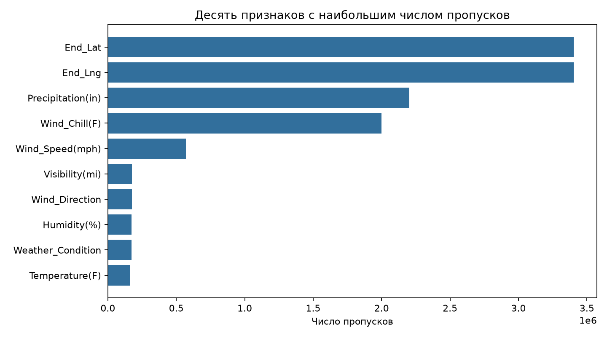

# Проверенные результаты проекта

AAI-2602. Bekmukhamedova Meruert, Aiganym Gadilova.
Это сохранённые результаты локальных запусков, а не утверждение о запуске в Colab.

## Графики полного набора

## Финальная временная оценка

| Модель | F1-macro | Accuracy |
|---|---:|---:|
| Dummy | 0,2394 | 0,9184 |
| Logistic Regression | 0,1384 | 0,2236 |
| HGB с погодой | 0,2081 | 0,3984 |
| HGB без погоды | 0,2085 | 0,3985 |

Test: 200 432 записи, естественные доли. Выбор HGB сделан по validation до test.
HGB не превзошёл baseline. Метрики слабых классов не исключены.
Старые 0,615/0,315 относятся к другому validation, не test.

[Подробный протокол](docs/FINAL_PROTOCOL.md),
[все классы HGB](outputs/final/hgb_none_test_classes.csv),
[матрица ошибок](outputs/final/hgb_none_test_confusion.csv),
[ошибки по погоде](outputs/final/hgb_none_test_weather_errors.csv),
[время и память моделей](outputs/final/validation_scores.csv),
[аудит и downcast](outputs/optimization_audit.json),
[проверка требований](docs/CRITERIA_STATUS.md), [отчёт](docs/REPORT.md).

GitHub показывает готовые таблицы и картинки без вычислений. Для интерактивных
графиков и воспроизведения используется основной ноутбук через кнопку Colab.
