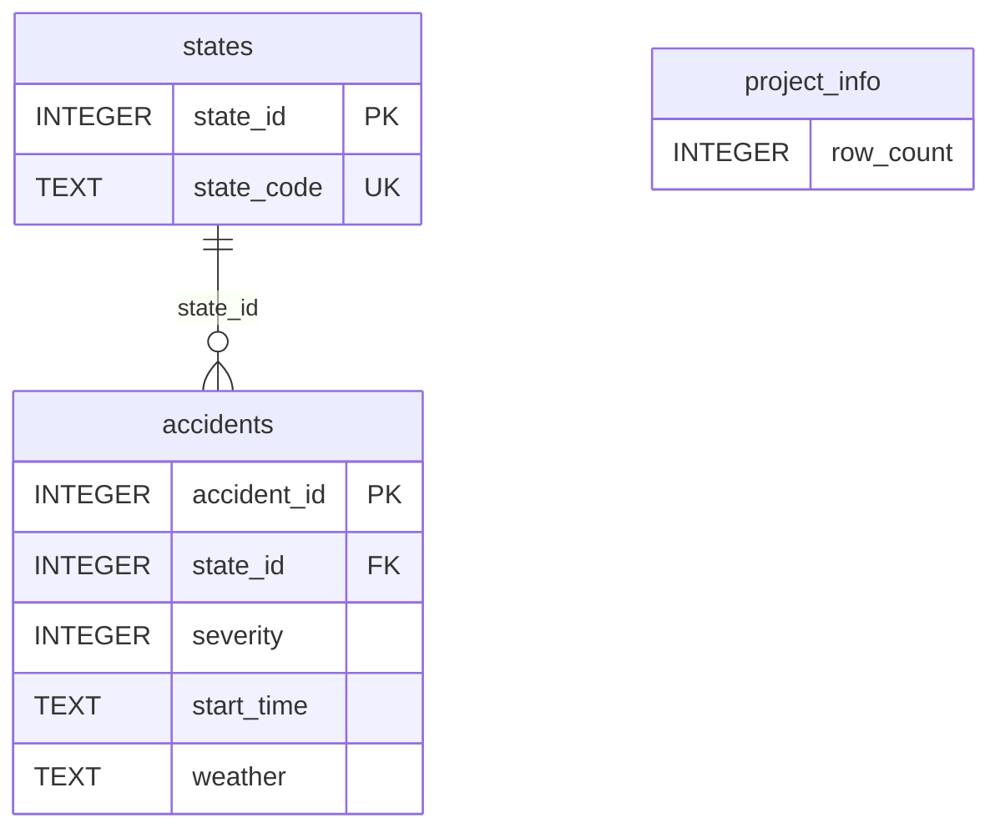

# Схема SQLite

`accident_id` — технический последовательный ключ строки в SQLite, не исходный
ID набора. Исходный ID сохраняется в Parquet и используется для ML-разбиения.
Справочник states исключает повторение кода штата в каждой строке. Остальные
атрибуты относятся непосредственно к наблюдению ДТП. Агрегаты `agg_severity`,
`agg_state`, `agg_year`, `agg_hour`, `agg_weather` являются производными таблицами
для интерфейса. `project_info` хранит число исходных строк загрузки.

Восемь запросов находятся в `src/database.py`, словарь QUERIES.
Их результаты сохраняются в `outputs/sql`. Среднее Severity в запросе №3 —
условное среднее порядкового кода, а не измерение травматизма или ущерба.
